<p align="center">
  
</p>

# Snow Trail: TryHackMe Advent of Cyber 2026

   

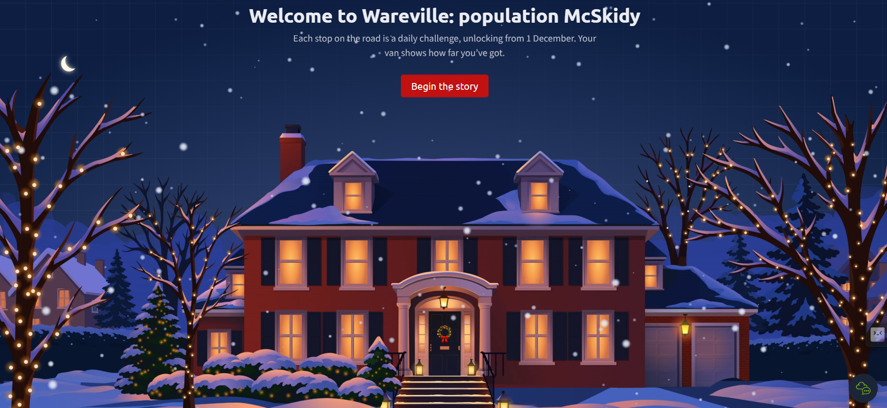

> **Spoiler notice:** this write-up contains the in-game clues (IP, alias). Skip it if you want to solve the lab first.

## Overview

"Welcome to Wareville: population McSkidy" is a story-driven forensics lab. A breach hit the office, and a Digital Assistant app on the phone emails five evidence-processing tasks. Each file has to be processed **on the right device**, and the goal is to collect **five clues** about whoever did it.

| | |
|---|---|
| **Event** | TryHackMe Advent of Cyber 2026 |
| **Lab** | Snow Trail (Wareville) |
| **Skills** | Log analysis, data recovery, evidence handling, phishing recognition, IoT containment |
| **Tools** | In-lab apps (SSD Recovery, Image Rebuilder), `grep`, phone camera |
| **Completed** | 2026-11-23 |

## The setup

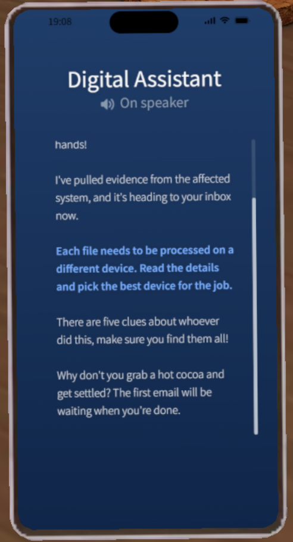

The Digital Assistant explains the rules: evidence has been pulled from the affected system and arrives by email, every file needs a different device, and there are five clues to find.

The tutorial walks you through the 3D office (walk to the cocoa station, make cocoa, take the mug to your table, free your mouse, open your phone). The clue counter starts at **0/5**.

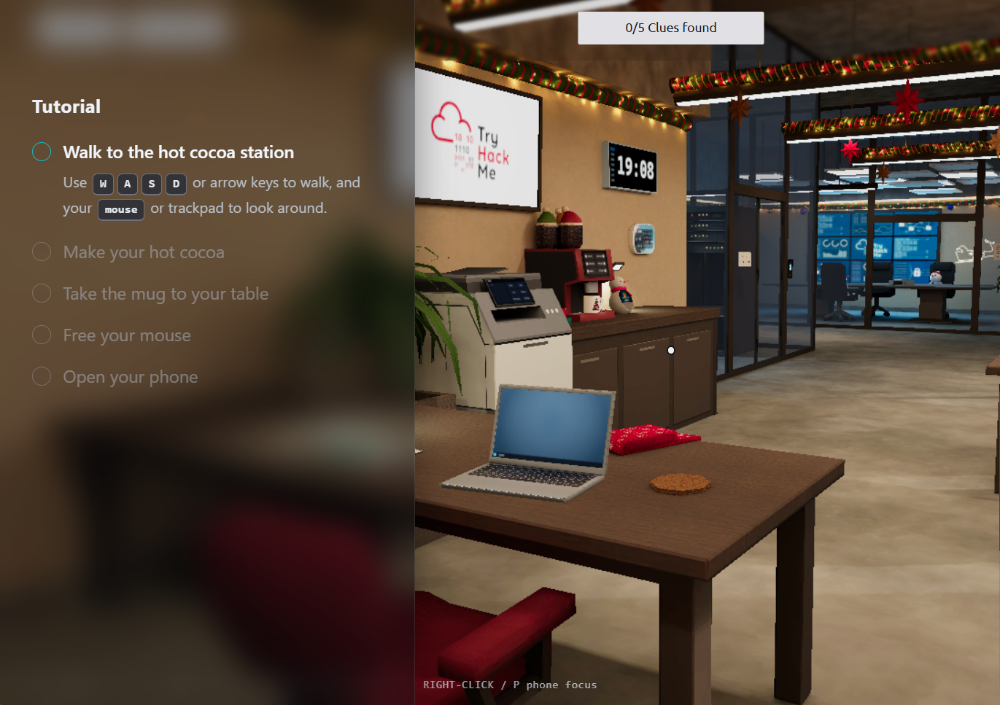

The office also has a smart speaker (the snowman), which matters at the end of the lab.

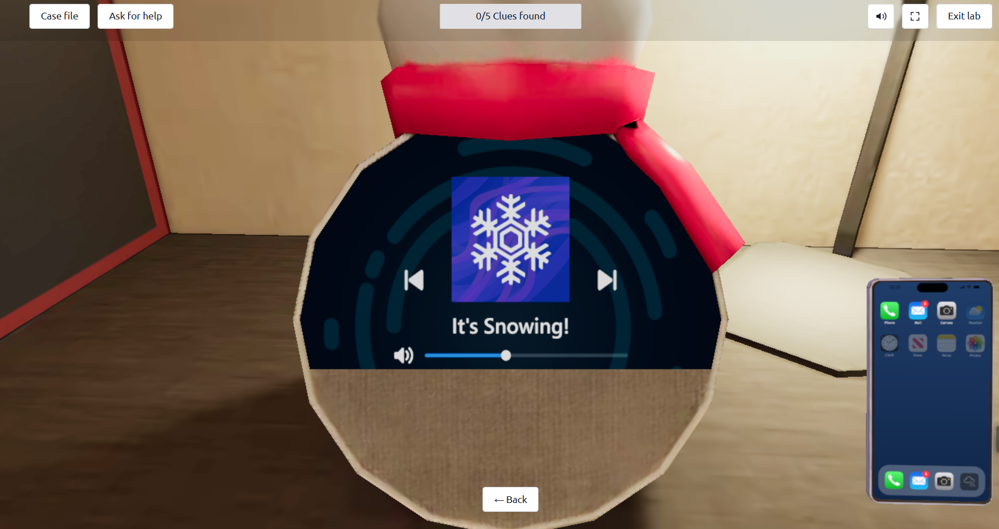

## Summary

| Task | Goal | Device logic | Result |
|---|---|---|---|
| 1. Repair 4K footage | Repair surveillance video, find the breach time | Very large file, so a powerful computer (Workstation) | Time of the breach from the footage |
| 2. Search the network log | Find the IP the hacker connected from | Always-on machine that manages the network (office server) | `197[.]45[.]82[.]16` |
| 3. Recover browser profile | Recover the hacker's alias from a damaged computer | Computer can't be moved, so a portable battery-powered device | Alias `GBies` |
| 4. Restore evidence image | Rebuild a scrambled image, find where it was taken | Heavy processing without overheating | Image rebuilt (`IMG_7783.jpg`) |
| 5. Scan QR code | Read a QR code for the hacker's machine serial number | A device with a camera (phone) | Turned out to be the hacker's email |
| Containment | Find three IoT devices and disconnect them | Identify devices that connect to Wi-Fi to do one job | Speaker, climate panel, printer |

## Task 1: Repair 4K footage

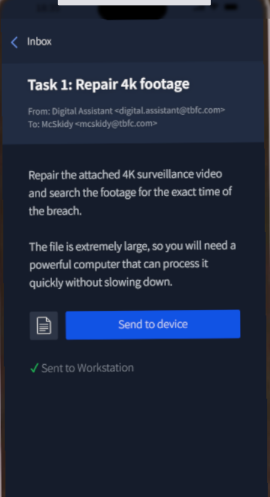

**Brief:** repair the attached 4K surveillance video and search the footage for the exact time of the breach. The file is extremely large, so it needs a powerful computer that can process it quickly without slowing down.

**Decision:** I sent the file to the **Workstation** (the screenshot shows "Sent to Workstation").

**Why:** repairing and scrubbing a large 4K video is heavy on CPU, GPU and memory. A phone or a small laptop would stall. Matching the job's compute needs to the device is the core idea of the whole lab.

**Takeaway:** the footage gives a time anchor that other evidence (logs, files) can be correlated against.

## Task 2: Search the network log

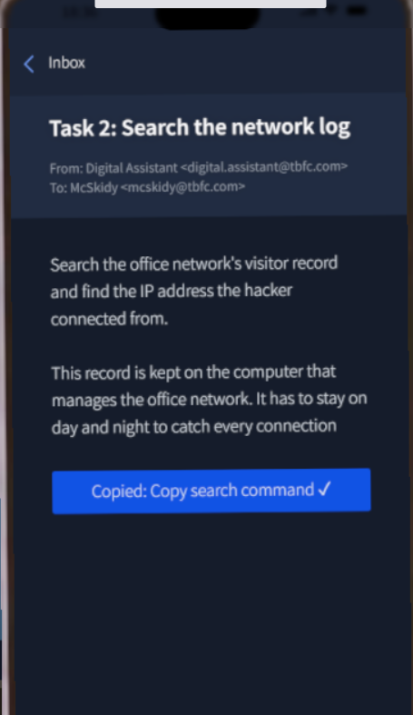

**Brief:** search the office network's visitor record and find the IP the hacker connected from. The record is kept on the computer that manages the office network and has to stay on day and night.

**Decision:** the **office server**. It is the always-on machine, and the terminal prompt is `sysadmin@office-server`.

**Command (supplied by the game):**
```bash
grep "05:43" /var/log/network.log
```

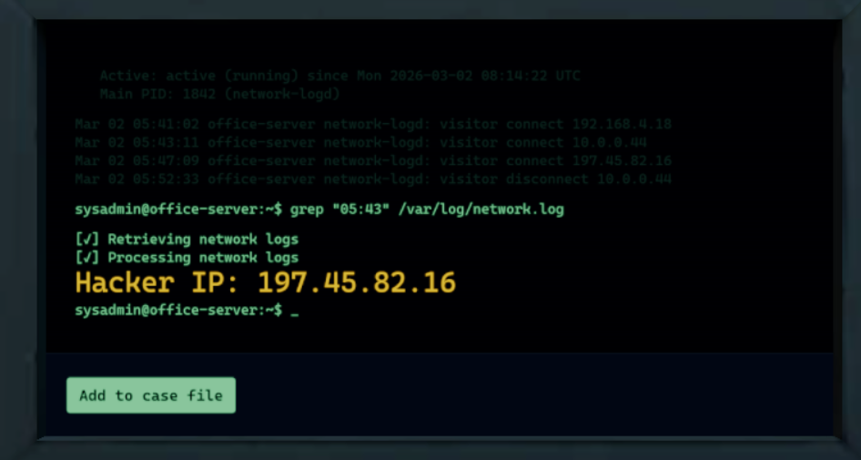

**Log excerpt (from the screenshot):**
```
Mar 02 05:41:02 office-server network-logd: visitor connect 192.168.4.18
Mar 02 05:43:11 office-server network-logd: visitor connect 10.0.0.44
Mar 02 05:47:09 office-server network-logd: visitor connect 197.45.82.16
Mar 02 05:52:33 office-server network-logd: visitor disconnect 10.0.0.44
```

**Result:** `Hacker IP: 197[.]45[.]82[.]16`

**Why this IP stands out:** `192.168.4.18` and `10.0.0.44` are private (RFC 1918) addresses, so they are inside the office network. `197.45.82.16` is a public address connecting as a visitor, which does not fit.

**Analyst note:** the time filter in the supplied command was `05:43`, but the public IP appears at `05:47:09` in the excerpt. In a real investigation I'd widen the window or search by IP (`grep "197.45.82.16" /var/log/network.log`), because a narrow time filter can miss the event you want.

## Task 3: Recover browser profile

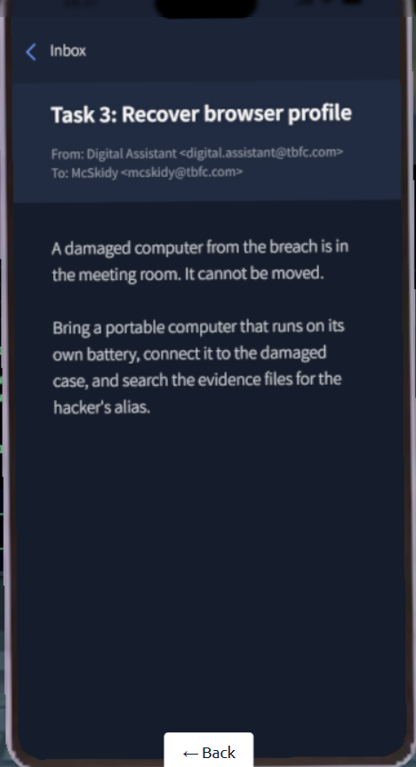

**Brief:** a damaged computer from the breach is in the meeting room and cannot be moved. Bring a portable computer that runs on its own battery, connect it to the damaged case and search the evidence files for the hacker's alias.

**Decision:** the **portable, battery-powered computer**, because the evidence stays where it is and the analysis device goes to it.

**Recovery:** the SSD Recovery tool reports a damaged 512 GB SSD, then "Recovery complete".

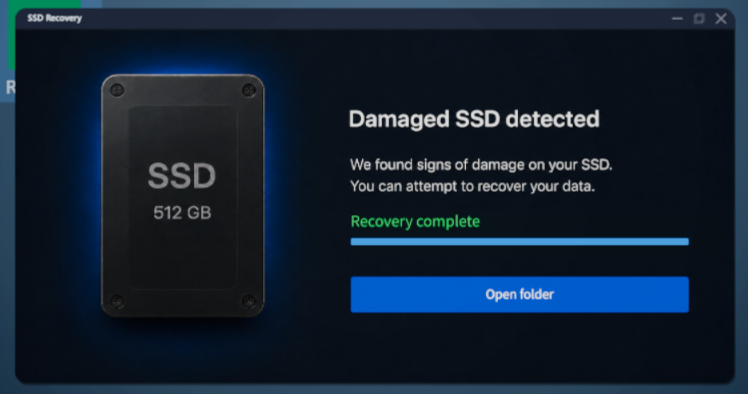

The recovered folder holds one file, `evidence_alias.txt`.

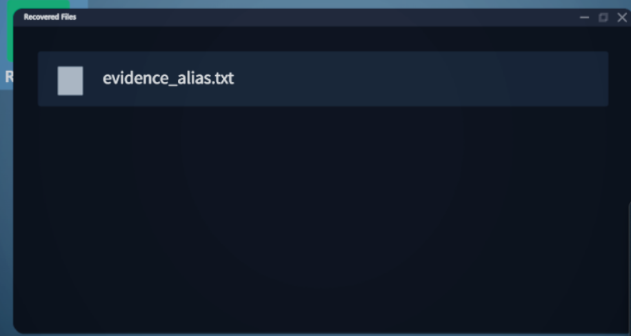

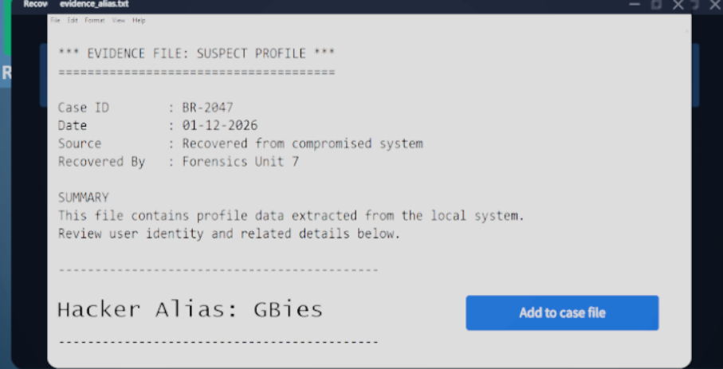

| Field | Value |
|---|---|
| Case ID | BR-2047 |
| Date | 01-12-2026 |
| Source | Recovered from compromised system |
| Recovered by | Forensics Unit 7 |
| **Hacker alias** | **GBies** |

**Takeaway:** note how the file records the case ID, source and who recovered it. That is evidence-handling metadata: it ties an artifact to a case and a person.

*Real-world note:* on a real case I would image the drive through a write blocker and analyze the copy, not the original.

## Task 4: Restore evidence image

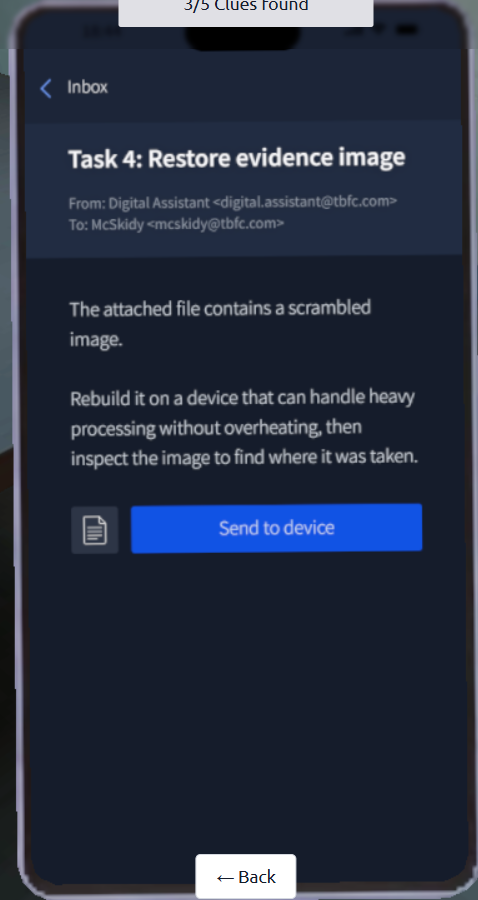

**Brief:** the attached file contains a scrambled image. Rebuild it on a device that can handle heavy processing without overheating, then inspect the image to find where it was taken. The clue counter shows **3/5** at this point.

**Process:** the Image Rebuilder shows the file as `IMG_7783.jpg`, a 4032 x 3024 JPG recovered from a mobile device. It runs four checks in order: file signature (valid), file structure (repairing), data blocks (pending) and image recovery (pending).

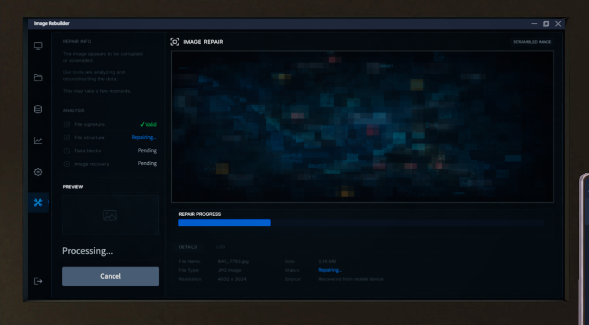

**Takeaway:** a valid file signature with a damaged structure is a typical corruption pattern, so the file type is recognized but the data blocks need repairing. Rebuilding a high-resolution image takes sustained processing, which is why the brief stresses overheating.

*Real-world note:* after restoring an image I would also check its metadata (for example `exiftool IMG_7783.jpg`) for GPS coordinates, camera and timestamps, alongside visual landmarks.

## Task 5: Scan QR code

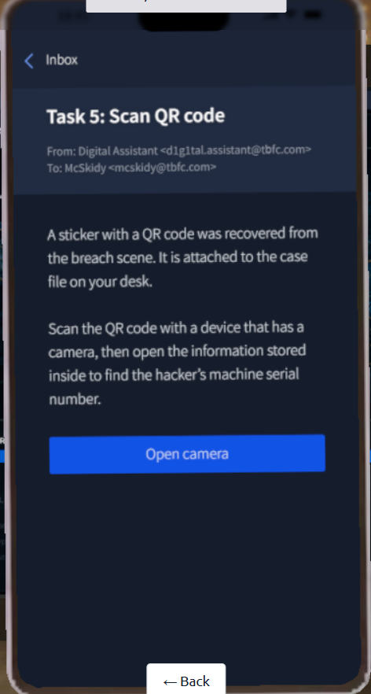

**Brief:** a sticker with a QR code was recovered from the breach scene. Scan it with a device that has a camera, then open the information inside to find the hacker's machine serial number.

**Decision:** the **phone**, using "Open camera".

**The twist:** right after this task, the Digital Assistant says the last email **was sent by the hacker**, who has taken control of most devices and can still reach anything on the network.

**Red flag that was in plain sight:**

| Email | Sender |
|---|---|
| Tasks 1 to 4 | `digital.assistant@tbfc[.]com` |
| Task 5 | `d1g1tal.assistant@tbfc[.]com` |

The domain is the same, but the local part swaps the letters `i` for the digit `1`, and the display name still reads "Digital Assistant". This is a lookalike sender combined with a **QR code**, a technique often called quishing (QR-code phishing). The closest MITRE ATT&CK match is **T1566 (Phishing)**.

**Takeaways:**
- Check the real address, not the display name.
- A QR code hides its destination, so treat unexpected codes like unexpected links.
- Trust built over several genuine messages makes the spoofed one more convincing.

## Containment: disconnect the IoT devices

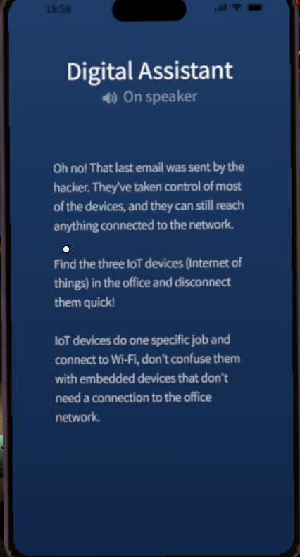

**Brief:** find the three IoT devices in the office and disconnect them quickly. IoT devices do one specific job and connect to Wi-Fi, and they should not be confused with embedded devices that don't need the office network.

**Devices disconnected:**
1. **Smart speaker** (the snowman). The assistant confirms it is IoT because it is always connected to the internet, which is how it answers questions.
2. **Smart climate / thermostat panel** (temperature, fan, heat, cooling controls) with a DISCONNECT button.
3. **Network printer** (Print, Copy, Scan, Scan to, Connect to, Settings) with a DISCONNECT button.

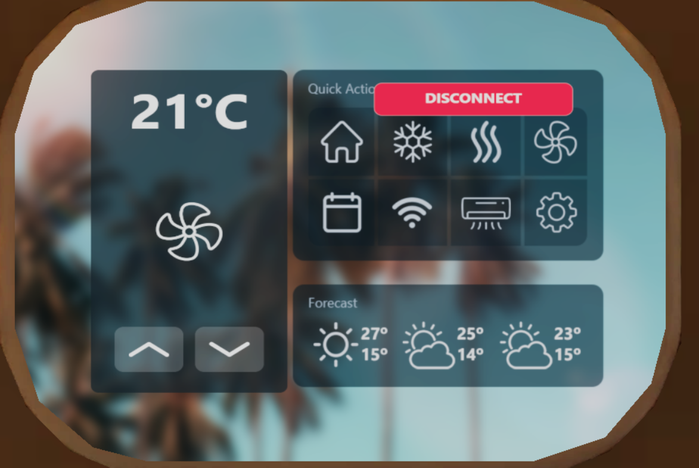

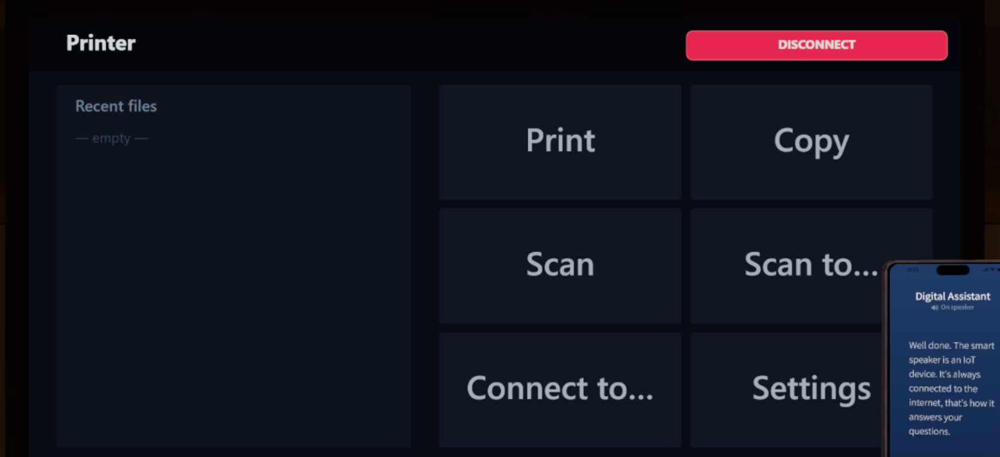

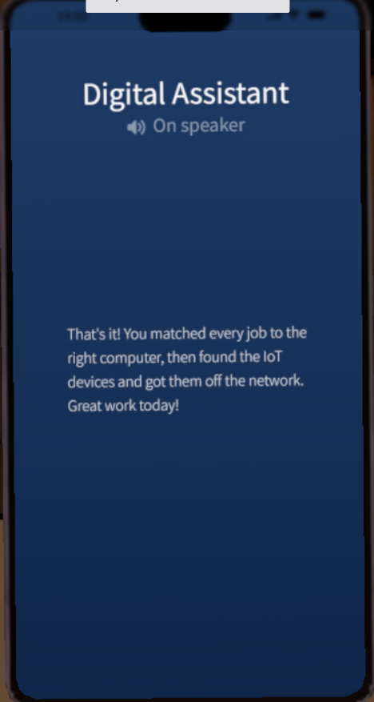

**Why IoT first:** these devices are always on the network, often lack endpoint protection and are rarely patched, so an attacker who controls them keeps a foothold. Isolating them fast is standard containment.

## Evidence summary (defanged)

| Item | Value | From |
|---|---|---|
| Attacker IP | `197[.]45[.]82[.]16` | Task 2 |
| Hacker alias | `GBies` | Task 3 |
| Case ID | BR-2047 (Forensics Unit 7) | Task 3 |
| Evidence file | `evidence_alias.txt` | Task 3 |
| Restored image | `IMG_7783.jpg` (4032 x 3024) | Task 4 |
| Spoofed sender | `d1g1tal.assistant@tbfc[.]com` | Task 5 |
| Disconnected devices | Smart speaker, climate panel, printer | Containment |

## Timeline (from the log excerpt, 2 March)

| Time | Event |
|---|---|
| 05:41:02 | Private IP `192.168.4.18` connects |
| 05:43:11 | Private IP `10.0.0.44` connects |
| 05:47:09 | **Public IP `197[.]45[.]82[.]16` connects** |
| 05:52:33 | `10.0.0.44` disconnects |

## What I learned

- **Right tool for the job:** match each task to the device that fits its constraints (compute, uptime, portability, camera).
- **Log triage:** a public IP among private ones is a quick anomaly check. Search by time and by IP, not only by time.
- **Evidence handling:** record case ID, source and who recovered each artifact.
- **Phishing awareness:** the attacker spoofed a trusted sender with `1` for `i` and added a QR code. Verify the real address every time.
- **Containment:** isolate IoT and other always-on devices early.

## SOC skills practiced

Log analysis, indicator extraction, phishing and quishing recognition, basic digital forensics, incident containment.

## Credits

Lab by [TryHackMe](https://tryhackme.com), Advent of Cyber 2026. All names and addresses in this lab are fictional.
